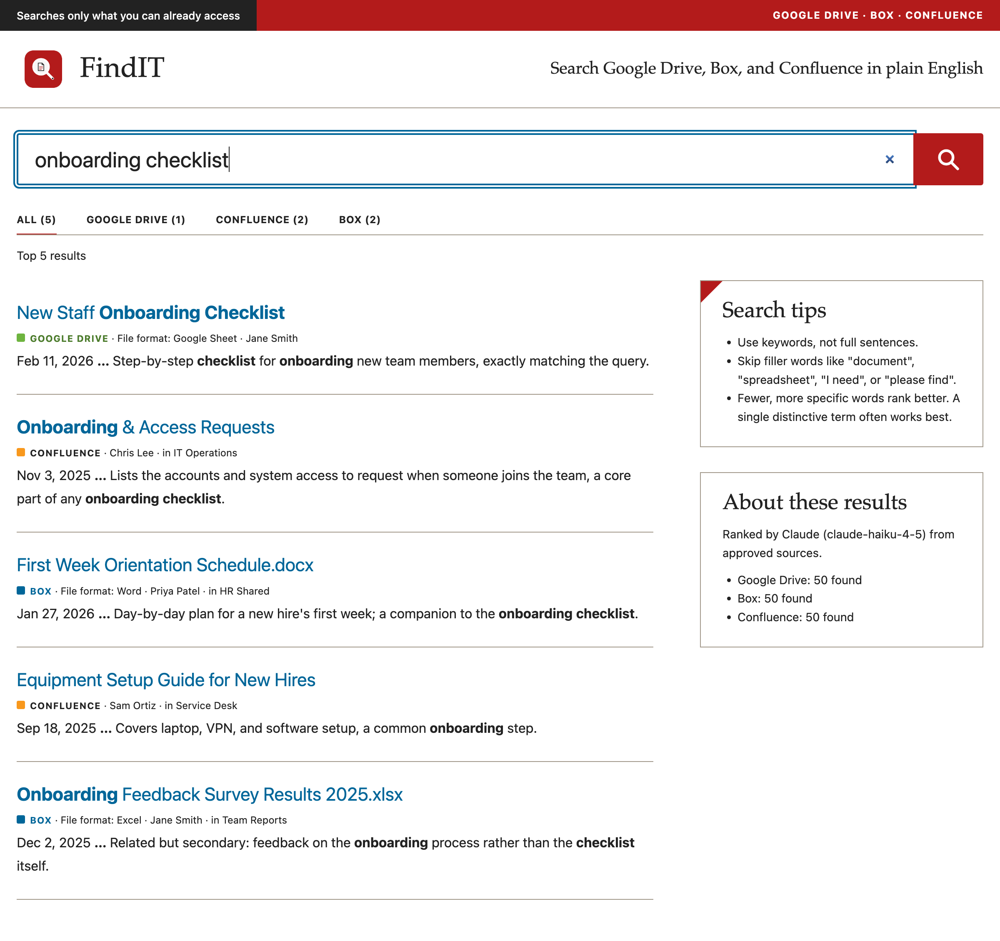

<p align="center"></p>

# FindIT

FindIT searches Google Drive, Box, and Confluence at once from a plain-English query, then uses Claude to rank the most relevant results. Run it from the terminal or in your browser.



*Browser view, shown with sample data and trimmed to five results (FindIT shows up to 10).*

The same search in the terminal:

```
FindIT results for: "onboarding checklist"

────────────────────────────────────────────────────
1. New Staff Onboarding Checklist
   Source: Google Drive
   Step-by-step checklist for onboarding new team members
   Google Sheet  ·  Modified 2026-02-11  ·  Owner: Jane Smith
   https://docs.google.com/spreadsheets/d/.../edit

2. Onboarding & Access Requests
   Source: Confluence
   Covers accounts and access to request when someone joins
   Modified 2025-11-03  ·  Owner: Chris Lee  ·  in IT Operations
   https://confluence.cornell.edu/spaces/...
```

(Each result shows where it came from, why Claude picked it, and quick metadata: type, modified date, owner, and folder/space.)

---

## Why I built it

At Cornell, our team's documents are spread across Google Drive, Box, and Confluence. Finding one usually means searching all three, each with its own search syntax, and then reading through dozens of results that only loosely match. FindIT searches all three at once and uses an LLM only for the step where it adds the most value: reading the merged results and picking the few that actually answer the question.

## How it works

1. **Search in parallel.** The query goes to Google Drive, Box, and Confluence at the same time, using each one's own API and the user's own credentials. Each source is optional.
2. **Data-scoping gate.** Before anything is sent to the model, each result is checked against `approved_sources.json`. The default is deny: a result is sent only if its source (or its specific folder or Confluence space) has been explicitly approved.
3. **AI re-ranking.** Approved results are sent to Claude (Haiku by default) through either the Cornell AI Gateway or your own Anthropic API key, and Claude returns the top matches with a one-line reason for each.
4. **Results.** Shown in the terminal, or in a small local web page styled after Cornell's search results, with tabs to filter by source.

## Design choices

FindIT handles institutional data, so most of the design work went into deciding what the AI is allowed to see:

- **The model ranks results; it never fetches them.** Search runs as the signed-in user, so FindIT can only find what that person can already open. For results that pass the gate, the model sees only the query, each file's name and modified date, and (for Confluence pages) an excerpt of up to 200 characters. It never receives full documents.
- **Default-deny scoping at the one outbound boundary.** There is exactly one function that calls the model, and it applies the scoping gate first, so nothing can reach the model without passing that check. New sources are excluded until someone approves them.
- **It works without AI.** With no API or gateway key, no approved sources, or the `--no-llm` flag, FindIT returns raw merged results and makes no outside call.
- **Audit without a second copy of the data.** Each search is logged locally with hashed document references, never file names or contents.
- **Bring your own credentials.** Every user registers their own Google and Box apps and uses their own Confluence token and Claude API or gateway key. No secrets are shared or stored in the repository.
- **Small, readable footprint.** Two Python files and a standard-library web server, with pinned dependencies.

For the security model, how each control was verified, and the known limits, see [SECURITY.md](SECURITY.md) and the [Security and Implementation Plan](docs/IMPLEMENTATION_PLAN.md). [ARCHITECTURE.md](ARCHITECTURE.md) covers the full technical design.

---

## What you'll need

FindIT is bring-your-own-credentials: you supply your own keys for whatever sources you want to search. Nothing is shared, and the tool searches only what you configure, so you only ever see data you already have access to.

Before you start:

- **Python 3.9 or later** with `pip`. Check with `python3 --version`, and use the *same* `python3` to install dependencies and to run FindIT.
- **A Cornell account**, for whichever of Google Drive, Box, and Confluence you set up.
- **At least one source configured** (Google Drive, Box, and/or Confluence). Each is optional; set up only the ones you want. Setup step 4 covers all three.
- **A Claude key** (optional but recommended). FindIT uses Claude to re-rank results. Use either a **Cornell AI Gateway key** (create one in the gateway's Virtual Keys section) or **your own Anthropic API key** from the [Claude Console](https://platform.claude.com) (billed pay-as-you-go; a Claude Pro chat subscription does not include API access). With a key, results are AI-ranked; without one (or with `--no-llm`), FindIT returns raw search results and makes no external call.

You register your own Google and Box apps and create your own Confluence token, so FindIT always runs as you.

---

## Setup

### 1. Get the code

Clone the repository (or download it) and open a terminal in the folder:

```bash
git clone https://github.com/dc774/FindIT.git
cd FindIT
```

### 2. Install the dependencies (one time)

Use the same `python3` you will run FindIT with:

```bash
python3 -m pip install -r requirements.txt
```

That is the only install step. No virtual environment is required. (If you prefer to keep these packages isolated, a venv works too, but it is optional.)

### 3. Add a Claude key (for AI ranking)

FindIT reads its Claude settings from a local `.env` file that stays on your machine:

```bash
cp .env.example .env
```

Open `.env` and uncomment **one** option:

- **Option A, your own Anthropic API key:** set `ANTHROPIC_API_KEY`.
- **Option B, Cornell AI Gateway:** set `ANTHROPIC_AUTH_TOKEN` to your gateway key and keep `ANTHROPIC_BASE_URL` as given. If both options are set, the gateway is used. For Option A, leave `ANTHROPIC_BASE_URL` commented out.

> **Which to choose:** if you are searching Cornell data, use the Cornell AI Gateway. Option A sends the query, file names, and excerpts to your personal Anthropic account instead of through Cornell's AI Gateway.

You can also set `FINDIT_MODEL` to choose the Claude model that ranks results (default `claude-haiku-4-5`). The Cornell AI Gateway accepts only the model IDs it has enabled.

The browser page uses Cornell's brand typography: Palatino for headings, and Freight Sans Pro for body text if you set `FINDIT_ADOBE_FONTS_ID` to an Adobe Fonts web project ID (see `.env.example`). Without it, the page uses a system sans-serif and makes no outside requests.

This step is optional: with no key (or when you pass `--no-llm`), FindIT skips re-ranking and returns raw results with no external call. A value exported in your shell takes precedence over `.env`.

### 4. Configure the sources you want

Set up **at least one** of the following. Each is optional; FindIT searches only the sources whose credential files are present.

**Google Drive** (register your own OAuth client):
1. In the Google Cloud Console, create or select a project, enable the Google Drive API, and configure an OAuth consent screen. With a Cornell (or other Google Workspace) account, choose **Internal**. With a personal Gmail account, Internal is not offered: choose **External** and add your own Google address under **Test users**.
2. Create an OAuth client ID of type **Desktop app**, download its JSON, and save it as `drive_credentials.json` in the FindIT folder. (`drive_credentials.example.json` shows the expected shape.)

**Box** (register your own app):
1. In the Box Developer Console, create a **Custom App** with **Standard OAuth 2.0 (User Authentication)**.
2. Set the redirect URI to `http://localhost:8081` and grant read access to files and folders.
3. Copy the template and fill in your app's credentials:
   ```bash
   cp box_credentials.example.json box_credentials.json
   ```
   Put your app's `client_id` and `client_secret` into the file.

**Confluence** (use your own personal access token):
1. In Confluence, open your profile menu (top right), then **Personal Access Tokens**, then **Create token**; copy it.
2. Copy the template:
   ```bash
   cp confluence_credentials.example.json confluence_credentials.json
   ```
3. Open `confluence_credentials.json`, paste your token into the `"token"` field. `"base_url"` is set to Cornell's Confluence; if you use a different Confluence site, change it to that site's address (for example `https://confluence.example.org`, with no trailing slash).

### 5. Approve sources for AI ranking (data scoping)

This controls which sources FindIT may send to the AI re-ranking step (the only thing it sends outside Cornell). It is **default-deny**: a source you do not list here is never sent to the AI, though it is still searchable in raw / `--no-llm` mode (which makes no external call). It does **not** affect what you can search or see, only what may be AI-ranked.

```bash
cp approved_sources.example.json approved_sources.json
```

The simplest setup is to approve each source you want ranked with `"approved": "all"` (the copied template already does this):

```json
{ "google_drive": {"approved": "all"}, "box": {"approved": "all"}, "confluence": {"approved": "all"} }
```

You do **not** need folder IDs. Only if you want finer control, replace `"all"` with a list of specific locations, Google Drive folder IDs, Box folder IDs, or Confluence space keys, e.g. `"confluence": {"approved": ["ITOPS"]}`. A source you remove (or set to an empty list) is excluded. Delete the file entirely, or use `--no-llm`, to skip AI ranking and get raw results only.

Each search is recorded to a local audit log at `~/.findit/audit.log` (document references are hashed; file contents are never logged).

> Matching is by a result's immediate location, so if you scope by IDs, a file in a *subfolder* of an approved Google Drive folder is not automatically covered unless you also list that subfolder, or approve the whole source.

### 6. Run it

Terminal:

```bash
python3 findit.py "onboarding checklist"
python3 findit.py --no-llm "onboarding checklist"   # raw results, no AI ranking
```

Browser:

```bash
python3 findit_web.py
python3 findit_web.py "onboarding checklist"   # opens with this search already run
```

The browser version starts a small local server and opens `http://127.0.0.1:8000`. If you include a search, the page opens with the results already showing. Each search also appears in the address bar (`?q=...`), so reloading or bookmarking the page re-runs it. Press Ctrl+C in the terminal to stop the server.

**First run:** for each of Google and Box that you configured, the browser opens once so you can sign in with your Cornell account and approve read access. After that, your logins are cached in `~/.findit/` and you will not be asked again. Confluence uses the token from step 4, so it never opens a browser.

---

## Using FindIT

Just describe what you are looking for in plain keywords:

```bash
python3 findit.py "quarterly budget"
python3 findit.py "vendor contract Acme"
```

Tips for better results:

- Use keywords, not full sentences.
- Skip filler words like "document", "spreadsheet", "I need", or "please find".
- Fewer, more specific words usually rank better.

FindIT searches whichever sources you configured, merges the results, and, when a Claude key is set, shows the top matches AI-ranked with a one-line reason each. Without a key (or with `--no-llm`), it shows raw results and makes no external call. How access works: you sign in to Google and Box as yourself and use your own Confluence token, so you only ever see data you already have access to.

When enabled, ranking runs on Claude Haiku by default (change it with `FINDIT_MODEL`), through the Cornell AI Gateway or your own Anthropic API key.

---

## Troubleshooting

**`ModuleNotFoundError`**: run the install command again with the *same* `python3` you use to run the script: `python3 -m pip install -r requirements.txt`.

**`No sources configured`**: set up at least one source in step 4 (`drive_credentials.json`, `box_credentials.json`, or `confluence_credentials.json`).

**Results come back without AI ranking**: that is expected when no Claude key is set or you passed `--no-llm`. Add an Anthropic API key or Cornell AI Gateway key to `.env` (step 3) to enable re-ranking.

**"Ranking step failed"**: usually an invalid key, a model your key cannot use, or a rate limit. Check the key in `.env`, and if you set `FINDIT_MODEL`, try removing it to use the default.

**Everything comes back raw even with a key, or "No approved sources configured"**: you have not set up `approved_sources.json` (step 5). Until you approve at least one source, nothing is sent to the AI step. **"N result(s) outside approved scope were excluded"**: those results came from locations not in `approved_sources.json`; add the folder ID or space key if they should be ranked.

**Confluence returns nothing, or a 401 error**: your token in `confluence_credentials.json` is missing, wrong, or expired. Create a new one (step 4) and update the file.

**Box sign-in fails or the browser does not open**: make sure port 8081 is free the first time you run it.

**Need to sign in again to Google or Box**: delete `~/.findit/token.json` (Google) or `~/.findit/box_token.*` (Box) and run FindIT again.
